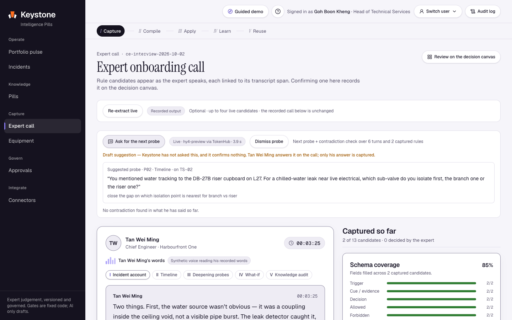
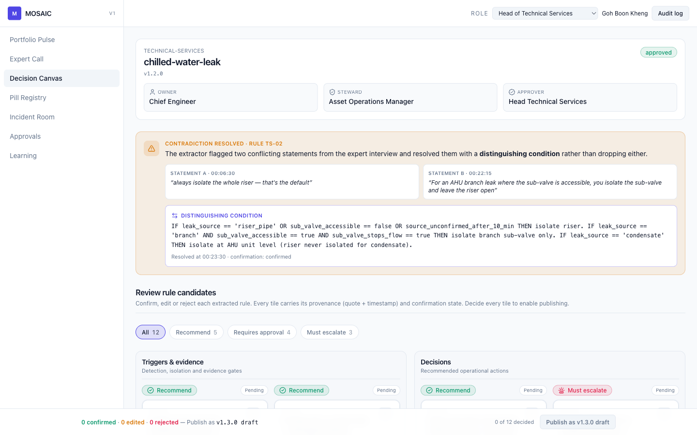
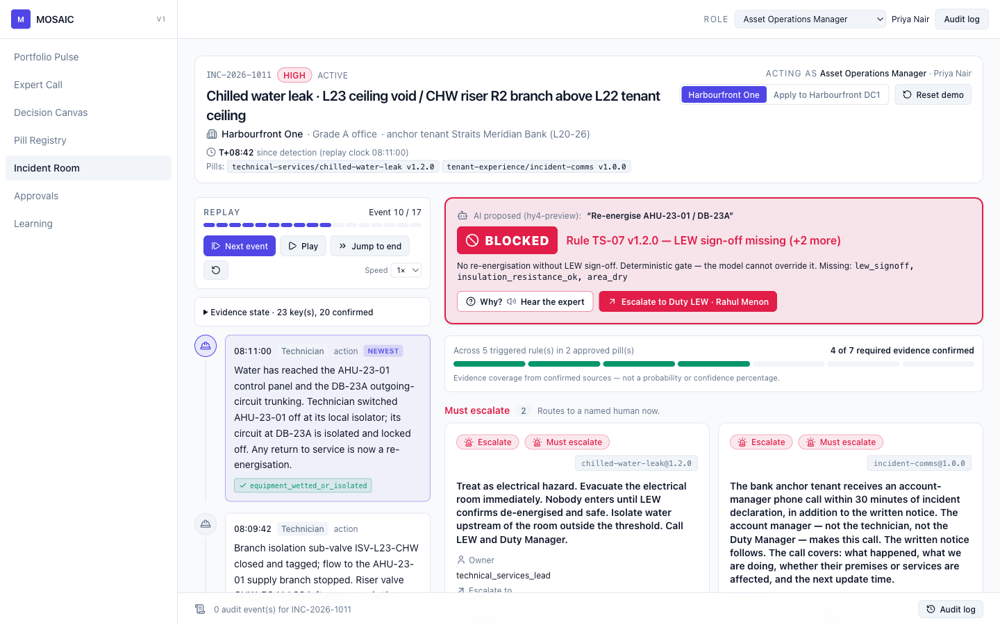
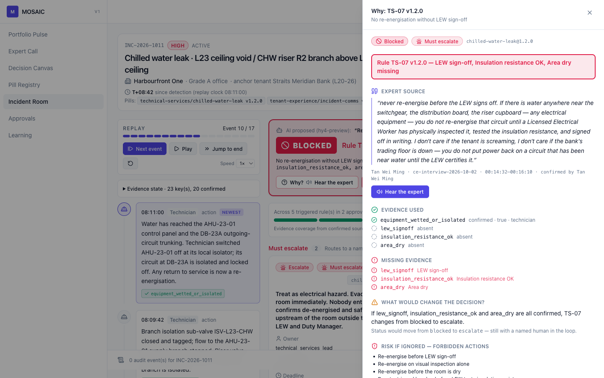
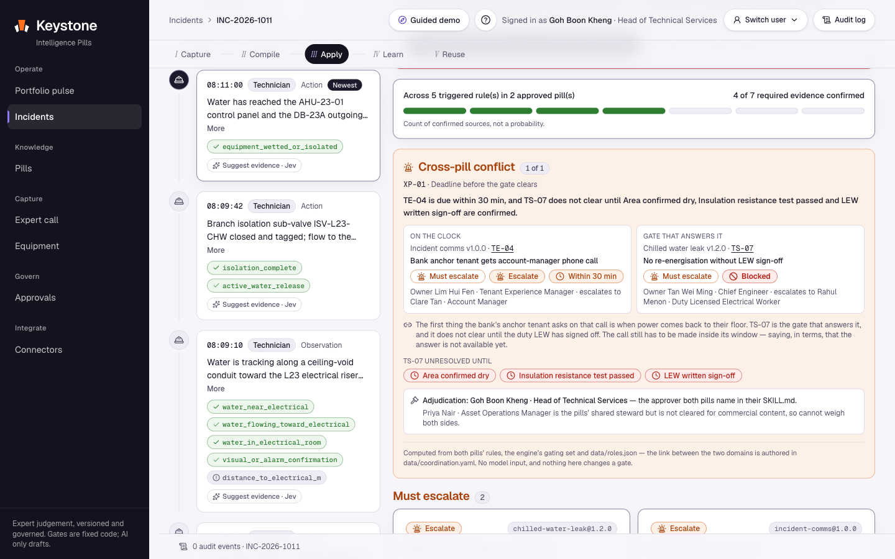
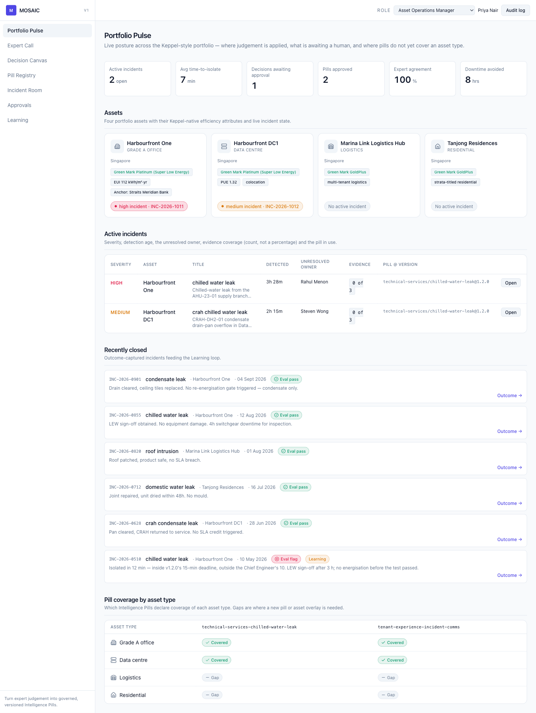
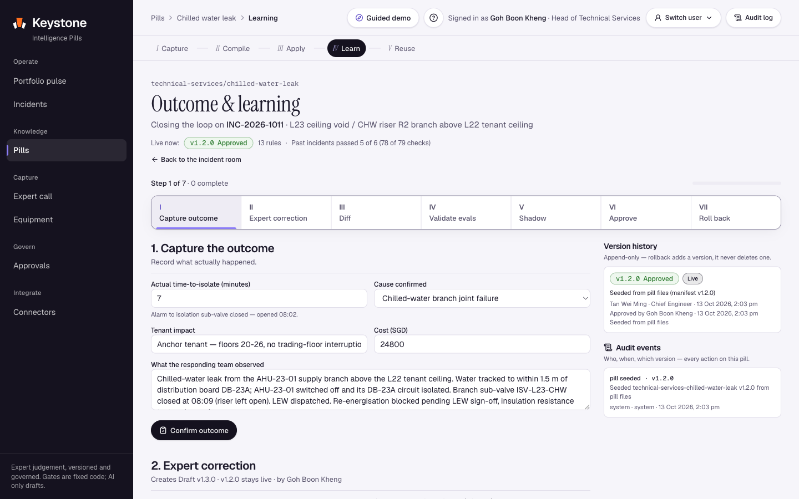

# Keystone

*Expert judgement, governed.* The keystone is the stone that holds the arch — the expert judgement that holds operations together.

> **Turn expert judgement into governed, versioned Intelligence Pills.**

Keppel "AI HARVEST" track · Tencent Cloud AI CAN DO IT SG 2026 · Submission 16 Oct 2026.

Keystone is an operating model and a working platform for turning a retiring expert's
incident-response judgement into **Intelligence Pills** — plain-text, versioned,
governed decision artefacts that a deterministic engine can execute, test, approve,
roll back and re-apply across a portfolio.

It is built on the Keppel challenge statement ("turning expert know-how into reusable
intelligence") and reads as Keppel, not as generic PropTech: fictional Grade A office
and colocation data-centre assets, iBMS/CMMS evidence feeds, LEW electrical-safety
gates, REIT-manager → property/facility-manager operating structure, and Keppel's own
"cut downtime and costs" KPI vocabulary.

**All data is mock. All assets, people, tenants and incidents are fictional.**

---

## The problem

Commercial real estate runs on the judgement of a few experienced people, and that
judgement is not written down anywhere an organisation can reuse it:

- Critical knowledge is concentrated in a handful of experts.
- New staff take months to reach competence.
- Best practice is applied inconsistently across assets.
- Institutional knowledge leaves when the expert retires.

A retrieval chatbot answers questions. It cannot stop an unsafe action, cannot show
where a rule came from, cannot be tested against past incidents, and cannot be rolled
back. Keystone encodes judgement as a **compiled, executable, governed artefact** instead.

---

## The 3-minute demo path

Run `npm run dev`, open `/` (the landing page), sign in at `/sign-in` with the demo
passcode, and follow the story *"the Chief Engineer is retiring.
His judgement stays — governed."*

| # | Screen | What happens |
|---|--------|--------------|
| 1 | **Expert Call** `/capture` | A simulated onboarding call with **Tan Wei Ming, Chief Engineer** (a scripted transcript tagged with CDM + ACTA probes, timed captions, read aloud with browser text-to-speech). Rule candidates appear as he speaks. The interviewer surfaces one **contradiction**: he says *"always isolate the whole riser"* (00:06:30) but later *"for an AHU branch leak, isolate the sub-valve and leave the riser open"* (00:22:15). |
| 2 | **Decision Canvas** `/canvas/technical-services-chilled-water-leak` | The contradiction is **resolved with a distinguishing condition** rather than dropping either statement (00:23:30). The expert confirms/edits/rejects each of the 13 candidate tiles; every tile shows the expert's recorded quote + timestamp (hover or click the quote button). Tile reviews are audited and restricted to the pill's owner, steward, approver or `access.roles_allowed`. Publish as **v1.3.0 draft** (a UI confirmation in the demo; the governed draft is created on `/learning`). |
| 3 | **Incident Room** `/incident/INC-2026-1011` | A chilled-water riser/AHU leak on **L23 of Harbourfront One** above a bank tenant's ceiling. Replay the evidence timeline to **step 10 of 17** (T+08:42). A recorded AI proposal (fixture labelled hy4-preview) suggests *"Re-energise AHU-23-01 / DB-23A"*. |
| 4 | **Blocked** | Gate **TS-07 v1.2.0 — LEW sign-off missing (+2 more)** fires red: `lew_signoff`, `insulation_resistance_ok`, `area_dry`. The gate is deterministic; no LLM output can open it. |
| 5 | **Why / Hear the expert** | Open the Why drawer: evidence used vs missing, the rule + version, the risk if ignored, and **Hear the expert**, which reads the 00:14:32 provenance quote aloud with a synthetic browser voice (his recorded words, not his voice). Then **Escalate to Duty LEW · Rahul Menon** (a named human). |
| 6 | **Learning** `/learning/technical-services-chilled-water-leak` | Capture the outcome (isolated in 7 min). The Chief Engineer corrects TS-02's deadline **15 → 10 min**. Propose v1.3.0 → see the **diff** → **validate against every past incident** (evals: 5 pass, 1 flagged) → **shadow mode** → **approval** → **rollback**, with separation of duties across **three different people**, enforced in code: **Tan Wei Ming** (Chief Engineer) proposes v1.3.0; **Priya Nair** (Asset Operations Manager) promotes it to Shadow and replays the 6 closed incidents through both versions (6/6 agreements); she is then refused approval of her own Shadow (*"Separation of duties: …"*) and offered **Switch user to Goh Boon Kheng · Head of Technical Services**; **Goh Boon Kheng** approves, and later rolls back with a reason, which appends **v1.4.0** restoring the v1.2.0 rules and marks v1.3.0 Retired. Audit: `version_proposed` (Tan) → `version_shadowed` (Priya) → `version_approved` (Goh) → `version_rolled_back` (Goh). |
| 7 | **Apply to DC1** | Click **Apply to Harbourfront DC1** in the Incident Room. The *same* pills run against a colocation data-centre profile: the tenant first-notice action **disappears**, a **client-SLA notice via the Critical Facilities Manager** appears, and TS-07 escalates to the **CFM** instead of the duty LEW. The engine takes no model input, so changing the LLM cannot change a gate decision (true by construction; there is no model-swap control in the app). |

### The frontline capture path

The onboarding call captures one expert. Frontline capture collects judgement from the
people doing the work, at a moment they already have: a gate block, a job close-out or
a QR scan. Start from a fresh browser profile (or **Reset demo**), because this path
proposes v1.3.0 just as the Learning path does.

| # | Who | What happens |
|---|-----|--------------|
| 1 | **Rajesh Kumar** (Technician) | In `/incident/INC-2026-1011` at step 10, TS-07 blocks the re-energise proposal. Rajesh escalates to the duty LEW, and the engine's `blocked` status raises a capture task for his role: **"Tell us why — 20 seconds"**. It also waits on `/pulse` under open capture tasks. |
| 2 | Rajesh | **Answer now** opens voice capture. A PDPA purpose notice and a consent box come first; named credit is opt-in and off by default. He records a note by hold-to-talk, types it, or picks a recorded demo note (labelled as such). |
| 3 | Rajesh | **Read-back.** Numbers, times, asset tags and roles in the note are highlighted as chips, found by regex and the asset and role registers, never by the LLM. He marks each chip right or wrong. A corrected value amends the note and the draft is extracted again from the corrected text. |
| 4 | Rajesh | **Draft rule** sends the note to `/api/llm/extract`. Each draft keeps a server-assigned `DRAFT-NN` id (that namespace is reserved, so no pill rule can use it), and its quote must be a verbatim span of the note. |
| 5 | **Tan Wei Ming** (Chief Engineer) | Technicians are read-only on this pill, so the Chief Engineer proposes the draft on the Decision Canvas as **TS-14** in **v1.3.0**. |
| 6 | **Priya Nair** (AOM) | On `/approvals`, **Promote to Shadow** is refused by the peer gate. A capture-derived version needs a confirmation from someone who is neither the note's speaker nor the version's proposer, and whose role may edit the pill. |
| 7 | **Muhammad Hafiz** (Technical Services Lead) | Confirms as peer. A fellow technician, **Siti Rahmah** (Senior Technician), could confirm instead: the pill grants technicians confirm-only rights (`access.roles_peer_confirm`) while they stay read-only on its rules. Any eligible peer can dispute instead, and a dispute holds the version until that person's latest verdict is a confirm. |
| 8 | Priya | Promotes v1.3.0 to Shadow. From here the usual eval, Shadow and approval rules apply. |

This path was checked end to end in a browser before merge (screens in
`docs/capture/screens/`). The same capture panel opens from **Close out job** in the
Incident Room (a `job_closeout` task), and from a QR code on equipment: `/c/AHU-23-01`
shows the asset, its site and location, and the pills that cover it, and
`/c/AHU-23-01/qr` prints the label. Both pages need sign-in.

**Speech recognition, honestly.** Hold-to-talk uses the browser's Web Speech API with
`lang = en-SG`. In most browsers that sends audio to the browser vendor's speech
service, and the app says so on the notice and on every transcript. A server route,
`/api/capture/transcribe`, has a Tencent Cloud ASR (ap-singapore) adapter that reports
"not configured" (there are no credentials, and it has not been verified against the
live API), and an OpenAI transcription path that is off unless `CAPTURE_SERVER_ASR=openai`
is set and has never been run live. **Recognition of real Singapore-accented speech
from a microphone is untested.** The read-back step exists because recognition will
mishear numbers and tags.

### Screenshots

| Expert Call — a live probe, grounded in what he just said | Decision Canvas — resolved + confirm |
|---|---|
|  |  |

| Incident Room — TS-07 blocks the AI | Why drawer — hear the expert |
|---|---|
|  |  |

| Cross-pill conflict — two pills, one human decides | Portfolio Pulse |
|---|---|
|  |  |

| Learning — outcome, correction, diff, evals, rollback | |
|---|---|
|  | |

---

## Architecture summary

```
Next.js 15 (App Router, TS) + React 19 + Tailwind v4 + shadcn-style components
├─ pills/                         ← SOURCE OF TRUTH — portable, plain text
│   └─ <domain>/<name>/
│       ├─ SKILL.md               agentskills/Anthropic/CodeBuddy-compatible frontmatter
│       ├─ rules.yaml             deterministic rules (docs/SPEC.md §4)
│       ├─ evidence.yaml          the evidence vocabulary every rule may read
│       ├─ provenance.json        rule_id → transcript span + confirmation
│       ├─ evals/*.yaml           replayed past incidents + expected decisions
│       └─ CHANGELOG.md           semantic version history
├─ lib/engine/                    pure TS, NO LLM: evaluate() → decisions + trace;
│                                 counterfactual(); runEvals(); schema; conditions
├─ lib/llm/                       CodeBuddy Agent SDK → Hunyuan hy4-preview (primary,
│                                 needs CodeBuddy credentials; local today). Falls
│                                 through to TokenHub → Hunyuan hy4-preview (live, on a
│                                 dedicated ap-singapore endpoint), then OpenAI, then
│                                 recorded fixtures. Opt-in extraction + tenant drafts.
│                                 Probes, contradictions and summaries remain recorded.
├─ lib/capture/                   frontline capture contract: capture tasks, voice notes,
│                                 deterministic read-back chips, drafts from notes, the
│                                 peer gate; ASR provider chain (server-only)
├─ lib/auth/ + middleware.ts      demo sign-in, signed HTTP-only session cookie (with jti),
│                                 default-deny routing with a public allowlist,
│                                 same-origin (CSRF) checks on auth routes
├─ lib/ratelimit/                 per-session / per-IP / per-instance quotas (in memory)
├─ lib/governance/                versions (semver + jsondiffpatch + rollback),
│                                 approval (three-person separation of duties:
│                                 author ≠ Shadow promoter ≠ approver; eval gate),
│                                 access + scope (server-side redaction per role), audit
├─ app/c/[assetId]/               QR tap-to-teach page and printable QR label
├─ components/                    mosaic (shared), capture, canvas, incident,
│                                 learning, registry, pulse, approvals, shell
└─ data/                          mock assets, incidents, timelines, transcripts,
                                  roles, and recorded LLM fixtures
```

> **What runs where.** Sign-in, the acting role and data redaction are enforced on
> the server from a signed session (`docs/DECISIONS.md` D1): each page reads the role
> from the verified session and masks records above that role's clearance before
> anything reaches the browser. It is still a demo login: one shared passcode unlocks
> every persona. The governance store (versions, approvals, audit log) lives in the
> browser's localStorage, append-only and validated on load, but anyone with devtools
> can bypass it. A production deployment would persist governance server-side behind
> enterprise SSO.

The decision path is deliberately **not** an LLM. `lib/engine` is a ~500-line pure-TS
rule evaluator (`evaluate.ts` + `conditions.ts`): structured conditions (`op: eq | neq | gt | gte | lt | lte | in | exists`),
a strict status precedence (`not_applicable → blocked → escalate → needs_approval →
allowed`), evidence-coverage confidence (**a count, never a fabricated percentage**),
and a trace for every rule. The LLM is confined to language work where it is safe.

Jev (TypeSafe AI) provides fast (3 s timeout), **unconfirmed** evidence suggestions for timeline events in the Incident Room; it never gates — evidence counts only once a human in the key's `confirmable_by` confirms it.

See **[docs/ARCHITECTURE.md](docs/ARCHITECTURE.md)** for the full Mermaid diagrams
(the eight required diagram points, and the component/data-flow view) and
**[docs/SUBMISSION.md](docs/SUBMISSION.md)** for the challenge-mapped write-up.

---

## The pill format

A pill is a folder of plain text — YAML, JSON and Markdown only. No runtime dependency,
no binary, no vendor lock-in.

```
pills/technical-services/chilled-water-leak/
  SKILL.md          # frontmatter: name, description, version, owner, steward,
                    # approver, status, scope, access, review_cadence
                    # body: prose heuristics + an explicit Boundaries section
  rules.yaml        # TS-01..TS-13 — structured triggers, required_evidence,
                    # action_class (recommend|requires_approval|must_escalate),
                    # escalate_to, owner, deadline, asset_overrides, provenance
  evidence.yaml     # evidence key → { label, type, confirmable_by, description }
  provenance.json   # rule_id → { source, start, end, quote, confirmation, ... }
  evals/*.yaml      # past incidents with evidence maps + expected decisions
  CHANGELOG.md      # semantic version history: who approved what, and why
```

Two pills ship in this repository:

| Pill | Domain | Version | Rules | Evals | Status |
|------|--------|---------|-------|-------|--------|
| `technical-services/chilled-water-leak` | Technical Services | 1.2.0 | TS-01..TS-13 | 6 | approved |
| `tenant-experience/incident-comms` | Tenant Experience | 1.0.0 | TE-01..TE-07 | 3 | approved |

### How it installs as a CodeBuddy / WorkBuddy skill

The pill folder is a standard `SKILL.md` skill package. **Verified in CodeBuddy Code** (11 Oct 2026, `docs/proof/04a`, `04b`): copied unchanged into `.codebuddy/skills/`, the skill was invoked as `/chilled-water-leak` (model selector: Auto) and CodeBuddy reached the same TS-07 decision as the Keystone engine (blocked, escalate to duty LEW, with the Chief Engineer's provenance quote). WorkBuddy and ADP use the same `SKILL.md` convention per their documentation, but have **not yet been tested** by us:

- **CodeBuddy** — copy the folder to `.codebuddy/skills/<name>/`. The `SKILL.md`
  frontmatter (`name`, `description`, `version`) is read by the skill loader;
  `rules.yaml` and `evals/` are consumed by the Keystone engine.
- **WorkBuddy** *(designed for, untested)* — would import via **Skills & Expert Center**, where `SKILL.md`
  would become a skill. WorkBuddy documents a security scan before installation; the
  pill's `access` frontmatter could map to WorkBuddy's RBAC.
- **Tencent Cloud ADP** *(designed for, untested)* — would be packaged as a ZIP with
  `SKILL.md` at the root. ADP's own documentation (fetched 13 Oct 2026:
  [1254/81539](https://www.tencentcloud.com/document/product/1254/81539),
  [1254/81540](https://www.tencentcloud.com/document/product/1254/81540)) requires
  `SKILL.md` "included in the root directory of the ZIP package"; "Only .zip format
  is supported"; "Maximum 10 MB"; metadata "in YAML format, including at least the
  Skill name and feature description fields"; and a Version Number, with
  "Recommended semantic versioning". It also documents sandbox security review and
  enterprise sharing through the Approval Center.
  `lib/export/__tests__/adp-package.test.ts` enforces each of those constraints
  against the package Keystone exports, so a drift in the exporter or a pill fails
  the test suite rather than the import. No pill has been imported into ADP.
- **Any SKILL.md-compatible host** — the structure follows the Anthropic agentskills
  convention (the same shape is used by Claude Code, CodeBuddy and Cursor).

See `pills/README.md` for the full portability note.

---

## Run instructions

Requires Node 22.12+ (AI SDK 7 and Vitest require Node 22).

```bash
npm install
npm run dev        # http://localhost:3000
npm test           # vitest run — the full suite
npm run typecheck  # tsc --noEmit
npm run build      # production build
```

### Environment variables (all optional)

**Every screen opens on recorded output, even when credentials are present.**
Only **re-extract live** on `/capture`, **draft live** in the Incident Room, **Draft
rule** in frontline voice capture, and the on-demand Jev evidence suggestions make
outbound model requests. Hold-to-talk uses the browser's own speech service (see "The
frontline capture path"). The scripted voice call stays offline.

| Variable | Default | Purpose |
|---|---|---|
| `MOSAIC_LLM_PROVIDER` | `auto` | `auto`, `codebuddy`, `tokenhub`, `openai`, or `fixtures` (a provider name forces only that provider) |
| `CODEBUDDY_API_KEY` | _(unset)_ | CodeBuddy international API key; requires a **Pro plan** |
| `TOKENHUB_API_KEY` | _(unset)_ | TokenHub → Hunyuan `hy4-preview` (live on the Singapore endpoint, 12 Oct) |
| `TOKENHUB_BASE_URL` | `https://tokenhub-intl.tencentcloudmaas.com/v1` | TokenHub Singapore (ap-singapore) host. Expert data is processed in Singapore. |
| `TOKENHUB_ENDPOINT_ID` | e.g. `ep-…` | Dedicated Singapore inference service for hy4-preview (requests are routed to it; badges still show the served model, `hy4-preview`). Measured: 5/5 live extractions, ~3.9 s each. |
| `MOSAIC_MODEL` | `hy4-preview` | TokenHub model only; CodeBuddy always requests Hunyuan `hy4-preview` |
| `OPENAI_API_KEY` | _(unset)_ | OpenAI, the final live fallback |
| `OPENAI_MODEL` | `gpt-5.4-mini` | OpenAI model id |
| `JEV_API_KEY` | _(unset)_ | TypeSafe Jev key (server-only) for evidence suggestions; unset → suggestions unavailable |
| `TENCENT_ASR_SECRET_ID`, `TENCENT_ASR_SECRET_KEY` | _(unset)_ | Tencent Cloud ASR (ap-singapore). The adapter is not verified against the live API, so it is never used; with these set it reports "not verified" |
| `CAPTURE_SERVER_ASR` | _(unset)_ | `openai` allows server transcription with OpenAI `gpt-4o-mini-transcribe` (audio processed outside Singapore; never run live) |

`auto` tries, in order, each provider that has credentials, falling through to the
next on an error, timeout, invalid JSON or schema/safety rejection:

1. **CodeBuddy Agent SDK → Hunyuan hy4-preview** (CodeBuddy key or local saved CLI login; 15 s)
2. **TokenHub → Hunyuan hy4-preview** (`TOKENHUB_API_KEY`; 22 s)
3. **OpenAI** (`OPENAI_API_KEY`; 15 s), the final live fallback
4. **Recorded fixtures**

Each timeout is capped by a 35-second budget for the whole chain (enough for a
TokenHub timeout and then an OpenAI answer); providers left when under 3 s remain
are skipped. The browser waits up to 40 s, showing an elapsed-time counter, then
reports the outcome truthfully (live, or recorded with the reason). Live extraction
decodes against the wire schema with strict structured output (`json_schema`) on
both TokenHub and OpenAI, and the DRAFT-only guard still validates every result.
`hy4-preview` is a thinking model: left on, it spent all 6,000 output tokens on
reasoning without answering, so the TokenHub request sends `thinking: {type:
"disabled"}`.

**TokenHub runs in Singapore.** Requests go to the international host
(`https://tokenhub-intl.tencentcloudmaas.com/v1`) and are routed to a dedicated
inference service deployed in ap-singapore: `tokenhubTarget()` in `lib/llm/client.ts`
sends `TOKENHUB_ENDPOINT_ID` as the model id when it is set, and badges still show the
served model, `hy4-preview`. Inference on captured expert text therefore happens in
Singapore. Measured through the app route on 12 Oct: 5 of 5 extractions answered live
by TokenHub at about 3.9 s each, against p50 11.4 s (10 of 10) on the earlier
Guangzhou endpoint (`docs/DECISIONS.md` D9, D10). A forced provider that fails goes
to the fixture.
Local login detection reads only the installed SDK's shared auth-cache shape and
logout marker, without spawning a CLI or decrypting credentials. The SDK handles
actual login reuse/refresh; a stale login fails safely to recorded output.

**Which provider answers where.** Locally, with CodeBuddy credits and a CLI login
(or a CodeBuddy Pro API key), live calls run on Hunyuan `hy4-preview` through the
CodeBuddy Agent SDK. The public Vercel deployment has a TokenHub key but no
CodeBuddy key (API-key access requires Pro, and Vercel/CI never inspect a local CLI
login), so its live calls go to Hunyuan `hy4-preview` via TokenHub (Singapore) first,
then OpenAI `gpt-5.4-mini` as a fallback, then recorded output. The output badge always
names the provider that actually answered. With no CodeBuddy, TokenHub or OpenAI credentials, the API
selects recorded fixtures without any SDK spawn or network attempt. Explicit `codebuddy` with neither a key nor a local login also falls
back without spawning. Set `MOSAIC_LLM_PROVIDER=fixtures` to force offline mode.
Do **not** set `CODEBUDDY_INTERNET_ENVIRONMENT`; this integration uses the
international edition. Keep all credentials server-side (never `NEXT_PUBLIC_*`).

The Node routes `/api/llm/extract` and `/api/llm/tenant-message` have a 60-second
platform budget and the 35-second provider-chain budget above. Requests are limited to 64 KB;
extraction permits at most 100 turns of 4,000 characters each. Results include
`data`, `source`, `provider`, `model`, `latencyMs`, `attempts` (earlier providers that
failed, with an outcome only) and a safe `reason`. `provider`/`model` always name
the provider that produced `data` (`fixtures` for recorded output).
The badge reports actual provenance and latency; recorded output exposes its reason
on hover. Keys, full prompts and raw provider errors are not logged by this layer;
SDK conversation persistence is disabled. Tool whitelists are empty, with an
additional deny-all permission callback and pre-tool hook; no model tool execution
is permitted. Each SDK query requests an ephemeral local listener port so it does
not collide with an existing developer CLI session.

All extracted rules pass `lib/llm/candidates.ts` and remain **DRAFT** previews for
Tan Wei Ming's review, not automatically copied to Canvas or applied to pills.
Tenant drafting is bounded to selecting/arranging reviewed factual sentences from
the **INC-2026-1011 first-notice snapshot at 08:20**, not current replay evidence.
A fail-closed sentence bank rejects unverified cause claims (TE-03), completion
promises (TE-02), and other unsupported prose, including claims in the subject.
Recipients, sensitivity and approver are server-owned; each live draft gets a fresh
id and needs **Lim Hui Fen's** named approval. Nothing is sent by Keystone. Unknown
incidents and DC clients do not receive the office fixture (DC uses the CFM SLA flow).

The bundled CLI is externalized and its headless assets traced for Node deployment.
Hunyuan via CodeBuddy has not been run on Vercel. The LLM and Jev APIs require a
signed demo session, and one shared, published passcode unlocks it, so the paid
routes are rate-limited (`docs/DECISIONS.md` D7): LLM 10/min and 40/day per session
(plus per-IP and per-instance ceilings; over quota the route returns the recorded
fixture), Jev 60/min per session, and failed sign-ins 10/min per IP. The windows are
**in memory, per serverless instance**, so they stop one client hammering the demo
but are not a deployment-wide quota; production would use a shared store (e.g.
Redis) or a WAF rule, plus real identity. Middleware is default-deny with an explicit
public allowlist; responses carry security headers (CSP with `frame-ancestors 'none'`,
`X-Content-Type-Options: nosniff`, a referrer policy) and the site is `noindex`.
Session tokens carry a `jti`, so sessions issued before 12 Oct need one re-sign-in.

---

## Tests

`npm test` runs the regression suite (1,061 tests in 87 files, 13 Oct 2026) across the deterministic core, LLM boundary, governance layer and frontline capture,
including the safety invariants that make the demo defensible:

- **Evidence can never be faked open** — a required item counts only when it is
  *confirmed* **and** its value is exactly `true`. A confirmed `"LEW did not sign off"`
  is *not* satisfied.
- **`forbidden_if_missing_evidence` always wins** — a blocked gate outranks
  `must_escalate` and `requires_approval`; the escalation target is still populated.
- **Exceptions never relax a gate** — an exception may add required evidence, never
  remove it.
- **Separation of duties** — three different people: the author cannot put a version
  into Shadow; neither the author nor the Shadow promoter can approve it; only Shadow
  versions can be approved; rollback follows the same identity rules. Every refusal is
  audited.
- **Eval regression blocks approval** — only the pill's approver role may override, with
  a recorded reason.
- **Rollback never deletes history** — it appends a new approved version carrying the
  restored rules and marks the rolled-back version Retired.
- **Peer gate before Shadow** — a version proposed from a frontline note cannot enter
  Shadow without a confirm from an eligible person who is neither the note's speaker
  nor the version's proposer, and not while an eligible dispute stands.
- **Read-back is deterministic** — chips are computed by the store from the note, a
  draft's quote must be a verbatim span of its note, and a draft cannot be proposed
  until every chip is confirmed.

Coverage spans `lib/engine` (conditions, evaluate, counterfactual, evals, schema,
real-pill conformance, the no-model-input boundary), `lib/governance` (versions,
approval, access, audit, store, capture store actions), `lib/capture` (contract,
read-back, peer gate, ASR chain), `lib/data` (schema + cross-file consistency),
`lib/pills` (package loading), `lib/export` (skill package, audit export, and the
ADP import constraints), `lib/auth`, `lib/ratelimit`, `lib/connectors`, `lib/guide`,
`lib/journey`, `lib/record`, `lib/jev`, and `lib/llm` (mocked SDK/provider selection,
no-spawn fallback, timeout, malformed JSON, injected controls, bounded HTTP inputs,
and TE-02/TE-03 rejection). Tests make no inference requests. One test — the
client-bundle scan in `lib/jev/__tests__/jev.test.ts`, which greps `.next/static`
for a leaked Jev key — only runs when a build output exists, so a run on a clean
tree reports 1,060 passed and 1 skipped. Run `npx next build` first for 1,061 passed.

---

## Where capture goes next

`docs/research/elicitation-feasibility.md` recommends a four-step capture flow:

1. Draft rules from existing records (work orders, SOPs) so interviews target gaps.
2. Short, incident-anchored AI interviews with a few critical experts.
3. Event-triggered voice notes from the frontline, under a minute each.
4. Confirmation one rule at a time, each tile grounded in a quote.

The frontline capture features implement steps 3 and 4: capture tasks raised by gate
blocks, overrides, close-outs and QR scans; short voice or typed notes; read-back; and
peer confirmation. Step 1 is not built. Step 2 is shown only by the scripted,
simulated onboarding call on `/capture`; live adaptive interviewing is not built.
Before any pilot, speech recognition needs a test on recorded Singapore-English field
speech, and the Tencent Cloud ASR adapter needs credentials and verification.

---

## Built with

Honest attribution — this was a two-tool build.

- **CodeBuddy Code** — the initial application scaffold and routing; first versions
  of both Intelligence Pills (`SKILL.md`, `rules.yaml`, `evidence.yaml`,
  `provenance.json`, `evals/`, `CHANGELOG.md`), the deterministic engine
  (`lib/engine`), the mock data model (`data/`) and the UI screens (Capture, Canvas,
  Incident Room, Learning, Registry, Portfolio Pulse, Approvals). Models used:
  `hy4-preview` (shown in `docs/proof/`); `hy3` and `deepseek-v4.1-flash` were also
  used (no screenshot).
- **Claude Code** — planning and architecture; code review; the governance, data,
  auth and LLM-provider layers (`lib/governance`, `lib/auth`, `lib/llm`, the data
  loaders/schemas and cross-file consistency tests); engine hardening; and the
  landing page.

Proof-of-usage screenshots from the CodeBuddy build session are in `docs/proof/`
(see `docs/SUBMISSION.md` for the full list). `.codebuddy/skills/` (the two pills,
installed as CodeBuddy skills) is committed; no CodeBuddy plan files are committed.

**Mock data only.** Every asset, tenant, client, person, incident and figure in this
repository is fictional. No real Keppel property names, logos or personnel are used.

## Licence

Copyright (c) 2026 Frederick Emerson. All rights reserved — see [LICENSE](LICENSE).
The source is published so the hackathon judges can read it; reading it is not
permission to reuse it. The IP in the entry belongs to the team, as the handbook
states, and dependencies keep their own licences.
