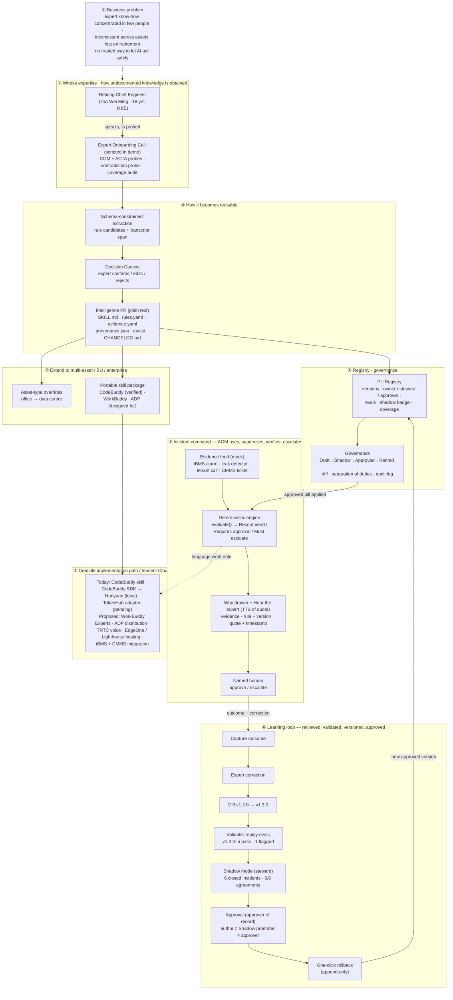
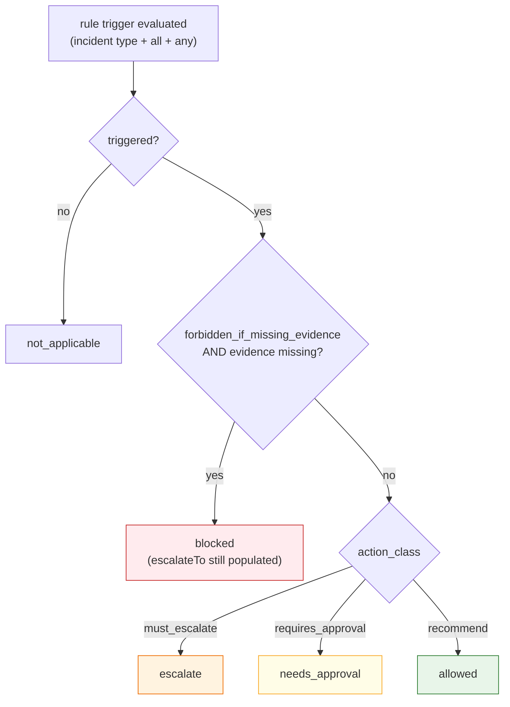

# Keystone — Architecture

Two views:

1. **The eight required diagram points** (`§1`) — capture → pill compile → registry /
   governance → incident command → learning loop → multi-asset.
2. **Component & data flow** (`§2`) — how the deterministic engine, the LLM boundary,
   the governance layer and the mock data fit together.

Implemented today: the deterministic engine, both pills, the governance layer, the data
model, the landing page, demo sign-in with a signed server session and server-side
redaction, and all seven app screens. The opt-in LLM path runs Hunyuan via the CodeBuddy
Agent SDK where CodeBuddy credentials exist (local); the public Vercel deployment falls
back to OpenAI gpt-5.4-mini; the TokenHub adapter is built but has not answered live.
Proposed / production-only: live BMS/iBMS/DCIM integration, the TRTC live voice call,
a server-side (e.g. Postgres) governance store, enterprise SSO, and the EdgeOne
deployment.

---

## 1. The eight required diagram points

**Point ①** is the problem statement above the flow. **Point ⑤** is the incident command
loop (AOM uses / supervises / verifies / escalates). **Point ⑥** is the post-deployment
governance loop. **Point ⑦** is multi-asset and enterprise reach. **Point ⑧** is the
Tencent Cloud implementation path. Points **②③④** are capture, compilation and the
registry/governance that turns a one-off answer into a reusable, governed capability.

Point **⑤ "why more than a chatbot"** is argued in `SUBMISSION.md` §11: the engine
produces a decision with a trace and a gate, not a retrieved snippet.

---

## 2. Component & data flow

```mermaid
flowchart LR
    subgraph SRC["Source of truth (plain text)"]
        PILLS["pills/&lt;domain&gt;/&lt;name&gt;/<br/>SKILL.md · rules.yaml · evidence.yaml ·<br/>provenance.json · evals/ · CHANGELOG.md"]
    end

    subgraph DATA["data/ (mock)"]
        ASSETS["assets.json"]
        INC["incidents.json"]
        TL["timelines/*.json"]
        TR["transcripts/*.json"]
        ROLES["roles.json"]
        FIX["fixtures/llm/*.json<br/>(recorded LLM fallbacks)"]
    end

    subgraph LOAD["Loaders"]
        PLOAD["lib/pills/load<br/>loadPill · loadAllPills"]
        DLOAD["lib/data<br/>zod-validated loaders"]
    end

    subgraph ENGINE["lib/engine — deterministic, no LLM"]
        EVAL["evaluate(pill, asset, incident, evidence)<br/>→ actions · confidence(count) · trace"]
        CF["counterfactual()"]
        EV["runEvals()"]
        COND["conditions · schema"]
    end

    subgraph LLM["lib/llm — provider chain"]
        CLIENT["CodeBuddy Agent SDK → Hunyuan hy4-preview<br/>→ TokenHub (AI SDK 7, pending)<br/>→ OpenAI gpt-5.4-mini (AI SDK 7)"]
        USE["live (opt-in): extraction · tenant message<br/>recorded only: probes · contradiction ·<br/>incident summary"]
    end

    subgraph AUTH["lib/auth + middleware"]
        SESS["signed session cookie (jti)<br/>role → server-side redaction<br/>default-deny allowlist · CSRF · headers"]
        RL["lib/ratelimit<br/>per session / IP / instance (in memory)"]
    end

    subgraph GOV["lib/governance — pure + client-safe"]
        VER["versions<br/>semver · diff (jsondiffpatch) · rollback"]
        APP["approval<br/>three-person separation of duties ·<br/>eval-regression gate"]
        ACC["access<br/>role/sensitivity RBAC · redaction"]
        AUD["audit"]
        STORE["store<br/>zustand + localStorage"]
    end

    subgraph UI["components/ + app/ — 9 pages"]
        LAND["/ Landing"]
        SIGN["/sign-in"]
        PULSE["/pulse Portfolio Pulse"]
        CAP["/capture Expert Call"]
        CANVAS["/canvas/[pillId] Decision Canvas"]
        REGI["/registry Pill Registry"]
        INCR["/incident/[id] Incident Room"]
        APPRO["/approvals"]
        LEARN["/learning/[pillId] Outcome & Learning"]
    end

    PILLS --> PLOAD
    DATA --> DLOAD
    PLOAD --> ENGINE
    DLOAD --> ENGINE
    ENGINE --> GOV
    ENGINE --> UI
    GOV --> UI
    LLM --> USE
    USE -->|"falls back to"| FIX
    DLOAD --> LLM
    PLOAD --> LLM
    UI -->|"user events"| GOV
    AUTH --> UI
    AUTH --> LLM
    RL --> LLM

    style ENGINE fill:#e8f5e9,stroke:#2e7d32
    style GOV fill:#e3f2fd,stroke:#1565c0
    style LLM fill:#fff3e0,stroke:#ef6c00
```

### Reading the boundary

- **`pills/` is the source of truth.** The engine reads `rules.yaml`; the app never
  generates decision logic at runtime.
- **`lib/engine` is deterministic and LLM-free.** Given the same pill, asset, incident
  and evidence it always returns the same actions and trace, and it takes no model
  input — so changing the LLM cannot change a decision.
- **`lib/llm` is confined to language work**, and every call site has a recorded
  fallback in `data/fixtures/llm/`, so the app runs fully offline.
- **Separation of duties is three people.** The author cannot put a version into
  Shadow; neither the author nor the Shadow promoter can approve it; only Shadow
  versions can be approved; rollback follows the same identity rules
  (`lib/governance/approval.ts`, `docs/DECISIONS.md` D2). Every refusal is audited.
- **Paid routes are rate-limited** (`lib/ratelimit`, `docs/DECISIONS.md` D7): LLM
  10/min and 40/day per session plus per-IP and per-instance ceilings, Jev 60/min per
  session, failed sign-ins 10/min per IP. The windows are in memory per serverless
  instance; production would use a shared store or a WAF rule.
- **`lib/governance` is pure and client-safe.** It owns versions, the approval gate,
  role/sensitivity redaction and the audit log. Redaction runs on the server per
  signed-in role (`lib/governance/scope.ts`, `docs/DECISIONS.md` D1). The runtime
  governance store is a zustand store backed by `localStorage` (append-only audit,
  validated on load), with "Export pill" and "Reset demo"; production would persist it
  server-side (e.g. a Postgres `pill_version` table).

### Status precedence (the safety core)

A required evidence key counts as satisfied **only when it is confirmed and its value is
exactly `true`**; exceptions may add required evidence but never relax a gate. These
invariants are enforced by the test suite (`npm test`).
